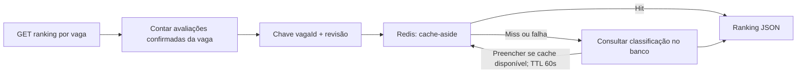

# Arquitetura — estado atual e evolução

Atualizada em 2026-10-25. Três serviços com bases e credenciais próprias; entidades JPA não são compartilhadas. Inscrição, avaliação, ranking/cache, Pact HTTP, fechamento, publicação durável e consulta definitiva estão implementados e validados.

| Contexto | Responsabilidade | Dados próprios |
| --- | --- | --- |
| Empregados | Perfil e qualificações | Empregados e itens de formação/experiência |
| Vagas | Oportunidades, critérios e publicação | Vagas, status, requisitos e outbox de resultados |
| Candidaturas | Inscrição, avaliação e classificação | Candidaturas, snapshots, outbox, avaliações, barreiras e resultados definitivos |

## Fluxo implementado

```mermaid
sequenceDiagram
    participant U as Cliente
    participant C as Candidaturas
    participant E as Empregados
    participant V as Vagas
    participant DB as Banco de Candidaturas
    participant K as Kafka
    U->>C: POST /api/v1/candidaturas
    C->>E: Resolver matrícula e consultar perfil
    C->>V: Resolver ID e consultar critérios
    C->>DB: Transação: candidatura + snapshots + outbox
    C-->>U: 201 (registro durável, avaliação pendente)
    C->>DB: Buscar pendências da outbox
    C->>K: CandidaturaRealizada (chave candidaturaId)
    K-->>C: Confirmação do envio
    C->>DB: Marcar publicação confirmada
    K->>C: Entrega ao grupo avaliacao-curricular
    C->>DB: Bloquear candidatura e consultar avaliação
    C->>DB: Se inédita, gravar resultado e identidade do evento
    C-->>K: Retorno do listener; confirmação do offset
    U->>C: GET /api/v1/candidaturas/{id}
    C-->>U: PENDENTE ou AVALIADA, elegibilidade e pontuação
```

Cada consulta HTTP possui timeout configurável. Referência inexistente ou vaga não aberta impede o registro. Os snapshots preservam o que foi observado na consulta, mas não bloqueiam alterações simultâneas no outro serviço; não há transação distribuída de inscrição.

Outbox e candidatura são gravadas atomicamente no PostgreSQL de Candidaturas. O dispatcher aguarda o ACK do Kafka e só então marca a publicação. Se o processo falhar entre ACK e commit, o evento pode ser reenviado: a garantia é **at-least-once**. A idempotência do produtor Kafka não elimina essa janela entre sistemas.

O consumidor usa apenas o snapshot original. Bloqueio pessimista da candidatura e resultado único por candidatura/evento protegem contra reentrega e concorrência; a gravação da avaliação é transacional. O evento é interno ao serviço e deve coincidir com o payload persistido. As regras de cálculo estão na [ADR-005](adr/ADR-005-fluxo-assincrono.md).

## Ranking e cache

`GET /api/v1/candidaturas/ranking/{vagaId}` retorna apenas avaliações elegíveis, ordenadas por pontos decrescentes, data de inscrição crescente e UUID crescente. É uma consulta parcial enquanto há inscrições pendentes, não o resultado oficial publicado.



Nova avaliação muda a revisão no mesmo commit em que fica visível. A próxima consulta procura outra chave; entradas antigas expiram pelo TTL. Uma leitura antiga atrasada preenche apenas a chave antiga e não sobrescreve a nova. Reentregas idempotentes e transações que sofrem rollback não mudam a revisão; avaliações de outra vaga não interferem.

Essa invalidação é lógica, sem DEL global nem evento separado. Depende de avaliações imutáveis e somente inseridas; edição/exclusão/restauração de dados exige rever a revisão e limpar o namespace correspondente. Cada GET ainda consulta a revisão no banco, mesmo no hit, e não há promessa de leitura em cache quando o banco está indisponível. Em erro do cache, a consulta completa do banco é usada como fallback.

Na aplicação o backend é Redis com JSON tipado e timeouts de 300 ms; nos testes padrão usa-se Caffeine explicitamente, sem Docker. Não é write-through. Custos, alternativas e limites estão na [ADR-006](adr/ADR-006-cache-ranking.md); evidências em [cache-ranking.md](evidencias/cache-ranking.md).

## Falhas e recuperação do fluxo assíncrono

- Envio Kafka que falha mantém a outbox pendente e interrompe o lote; um próximo ciclo tenta novamente.
- O listener não confirma processamento antes da transação de avaliação terminar. Falhas transitórias têm até duas novas tentativas, com backoff exponencial (padrão 1 e 2 segundos).
- JSON inválido ou evento inconsistente segue para `candidaturas.realizadas.DLT` sem retry de negócio. Falhas persistentes seguem para a mesma DLT após três tentativas totais. Se a publicação na DLT falhar, o erro não é tratado como recuperação bem-sucedida.
- A DLT preserva payload e metadados para investigação; não há consumidor nem replay automático dela. Após corrigir a causa, reenviar o mesmo evento com a mesma chave/IDs, sem fabricar um novo snapshot. A avaliação fica PENDENTE enquanto não houver resultado persistido, inclusive se houver uma mensagem na DLT.
- Inscrições históricas sem snapshots não são publicadas retroativamente. A retenção/limpeza da outbox e da DLT deve preservar pendências e rastreabilidade; não há expurgo automático nesta versão.

## Infraestrutura e testes

O perfil alvo A usa Kafka, PostgreSQL e Redis no Compose; os serviços executam na JVM. A outbox e as avaliações usam o banco exclusivo de Candidaturas. Os tópicos de candidatura e DLT têm três partições e fator de replicação 1, adequado somente ao nó local de desenvolvimento.

A suíte padrão usa H2, Caffeine e Kafka KRaft embarcado, sem Docker. Testes verificam consultas HTTP, snapshots, atomicidade da outbox, cálculo, reentrega, concorrência, retry/DLT e cache. O Pact exercita o cliente real de Candidaturas e verifica a API real de Vagas em porta aleatória com H2; a cópia versionada permite testar o provedor independentemente da ordem do reactor. Geração e verificação em [contrato HTTP](evidencias/contrato-http-vagas.md), decisão na [ADR-007](adr/ADR-007-contrato-http-vagas.md). Testes embarcados e validação com infraestrutura real são evidências distintas.

## Fechamento e publicação definitiva

```mermaid
sequenceDiagram
    participant U as Cliente
    participant V as Vagas
    participant C as Candidaturas
    participant K as Kafka
    U->>V: POST encerramento
    V->>C: Fechar admissões com barreira persistente
    C-->>V: Barreira confirmada
    V-->>U: EM_AVALIACAO
    U->>V: POST resultado
    V->>C: Verificar todas as inscrições avaliadas
    C-->>V: Prontidão e contagens
    V->>V: Commit: RESULTADO_PUBLICADO + outbox
    V-->>U: 202
    V->>K: ResultadoPublicado (chave vagaId)
    K-->>V: ACK; marcar outbox enviada
    K->>C: Evento ao grupo resultados-publicados
    C->>C: Bloquear processo, deduplicar e persistir ranking definitivo
    C-->>K: Confirmar após commit
    U->>C: GET resultado definitivo
    C-->>U: Evento/data originais, ranking e contagens
```

Uma linha de coordenação transacional em Candidaturas serializa brevemente admissões/fechamentos, após as consultas HTTP, impedindo inscrição tardia. O custo é contenção global nesse trecho, documentada na [ADR-008](adr/ADR-008-publicacao-resultado.md). Falha entre fechamento local e commit de Vagas exige repetir o comando; não há reabertura automática.

Vagas exige estado EM_AVALIACAO e prontidão (incluindo avaliações inelegíveis). Status e intenção são atômicos apenas no banco de Vagas; o resultado em Candidaturas é eventualmente consistente. A entrega é at-least-once e idempotente; divergência vai para DLT. A consulta definitiva é um snapshot persistido do banco, independente do cache parcial. CONCLUIDA é administrativa, não confirmação remota. Execução real, falhas e limites em [publicação](evidencias/publicacao-resultado.md).

## Evoluções e preparação da banca

- Revisão humana do grupo, papéis e ensaio cronometrado. O Pact cobre consultas HTTP de Vagas; os novos endpoints/eventos têm testes de integração, sem um segundo Pact.
- Evento `AvaliacaoConcluida`, se mantido no desenho final; ainda não é emitido. A consulta atual de ranking e sua invalidação leem a revisão no próprio banco e não dependem desse segundo evento.
- Revisão da política de exclusão de vaga, operações de correção/replay e retenção de eventos.
- Reprodução a partir de clone limpo e revisão final documentadas nas evidências de entrega, conforme forem concluídas.
